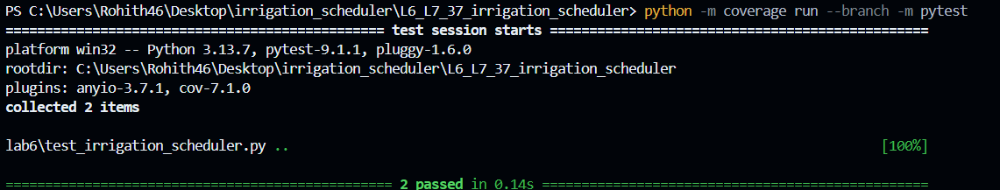
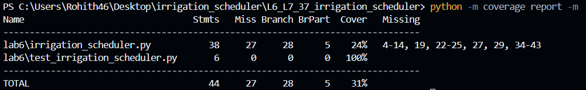
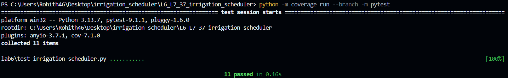
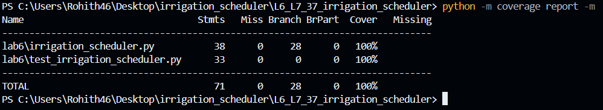

# Lab 6: Code and Branch Coverage Analysis

## Overview
This repository contains the code and test coverage analysis for the **Irrigation Scheduler** application. The goal of this lab is to understand code vs. branch coverage, identify untested paths, and write comprehensive test cases using `pytest` and `coverage` to achieve 100% code and branch coverage.

---

## Repository Structure
- `lab6/irrigation_scheduler.py`: The application logic script.
- `lab6/test_irrigation_scheduler.py`: The unit test suite.
- `screenshots/`: Terminal output verification screenshots.

---

## Coverage Analysis Reports

### 1. Initial Baseline Coverage (Before Adding Tests)
Running the initial test suite resulted in low coverage (24% line coverage) with several missing paths.

* **Initial Test Run:**
  

* **Initial Coverage Report:**
  

---

### 2. Final Coverage (After Adding Comprehensive Tests)
After writing targeted test cases covering all conditional branches, edge cases, and exceptions, we achieved **100% Code and Branch Coverage**.

* **Final Test Run (11 items passed):**
  

* **Final Coverage Report (100% Complete):**
  

---

## How to Run the Tests and Coverage

1. Install dependencies:
   ```bash
   pip install coverage pytest
   
2. Run tests with branch coverage:
   ```bash
   python -m coverage run --branch -m pytest
   
3. View the coverage report:
   ```bash
   python -m coverage report -m
